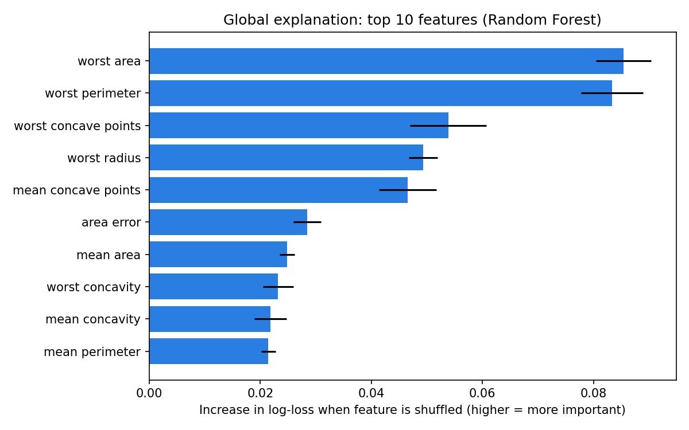
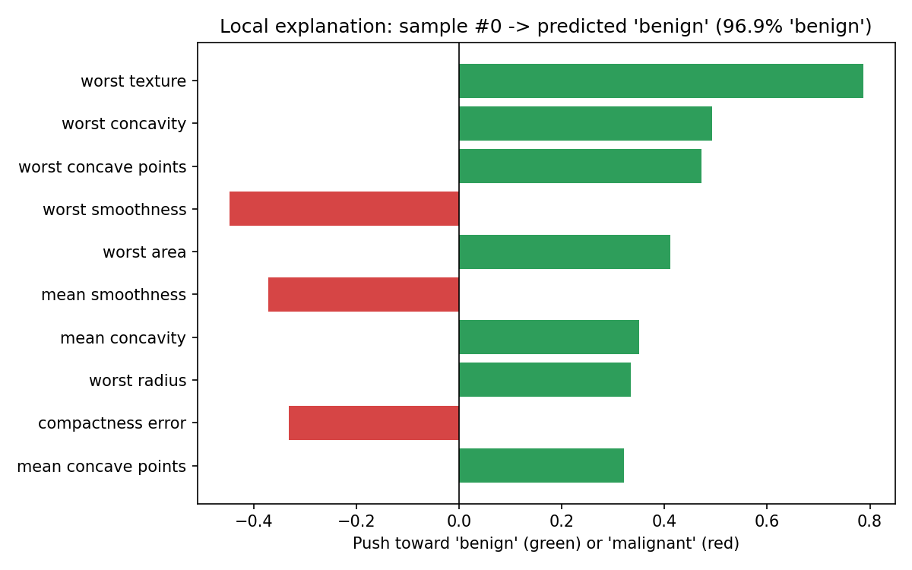

# 🔍 Explainable ML Classifier

A small, beginner-friendly project that shows **why** a machine learning model makes its predictions, not just how accurate it is.

It trains two models on the Breast Cancer Wisconsin dataset (built into scikit-learn, so no downloads or API keys) and explains them in two complementary ways:

| Explanation | Model | Question it answers |
|:--|:--|:--|
| **Global** | Random Forest | Which features matter most overall? |
| **Local** | Logistic Regression | Why did the model predict this for *this one* sample? |

> ⚠️ **Educational project only.** This is a demo of explainability techniques, not a medical tool.

## Results

Held-out test set (25% of the data, stratified, seed 42):

| Model | Accuracy | F1 | ROC-AUC |
|:--|:--:|:--:|:--:|
| Logistic Regression | 0.986 | 0.989 | 0.998 |
| Random Forest | 0.958 | 0.967 | 0.995 |

### Global explanation (permutation importance)

Shuffle one feature at a time and measure how much the model's log-loss gets worse. Bigger increase = the model relies on that feature more.



### Local explanation (single prediction)

For a linear model, each feature's contribution is exactly `coefficient × standardized value`. Green bars push toward *benign*, red bars toward *malignant*.



## Quick start

```bash
git clone https://github.com/riponalmamun/explainable-ml-classifier.git
cd explainable-ml-classifier

python -m venv .venv
source .venv/bin/activate        # Windows: .venv\Scripts\activate
pip install -r requirements.txt

python explain_model.py
```

Explain a different test sample:

```bash
python explain_model.py --sample-index 5 --top-k 8 --output-dir results
```

| Option | Default | Description |
|:--|:--:|:--|
| `--sample-index` | `0` | Which test sample to explain locally |
| `--top-k` | `10` | Number of features shown in each plot |
| `--output-dir` | `outputs` | Where plots and `report.json` are saved |
| `--seed` | `42` | Random seed for reproducibility |

## How it works

1. Load the dataset and make a stratified train/test split.
2. Train a **Logistic Regression** (scaled features) and a **Random Forest**.
3. Evaluate both on the test set (accuracy, F1, ROC-AUC).
4. **Global:** compute permutation importance for the Random Forest, using log-loss because it reacts to confidence changes, not only to flipped predictions.
5. **Local:** break one Logistic Regression prediction into per-feature contributions.
6. Save the plots and a `report.json` summary.

## Things to know

- Many features in this dataset are highly correlated (for example radius, perimeter, and area). Permutation importance can under-credit a feature when a correlated twin still carries the same information, so read the ranking as a guide and not as exact truth.
- Logistic Regression is interpretable by design, which is why its local explanation is exact. Complex models usually need approximations such as SHAP or LIME.

## Ideas to extend

- Add SHAP values for the Random Forest and compare them with permutation importance.
- Try other datasets or models (gradient boosting, SVM).
- Add partial dependence plots for the top features.

## Tech stack

Python · scikit-learn · pandas · NumPy · Matplotlib

## License

MIT, see [LICENSE](LICENSE).

---

Built by [Md. Ripon Al Mamun](https://github.com/riponalmamun)
